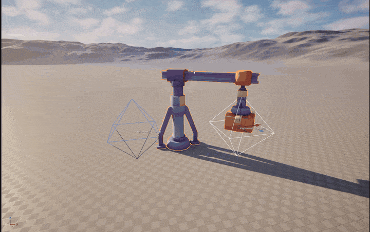
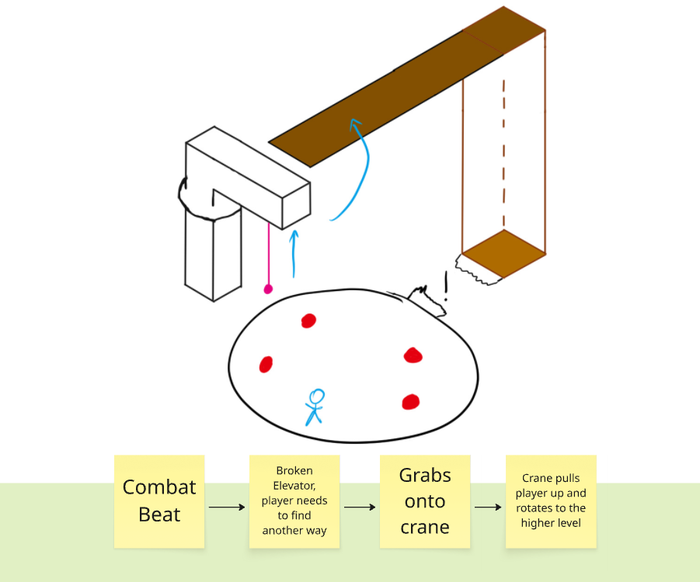
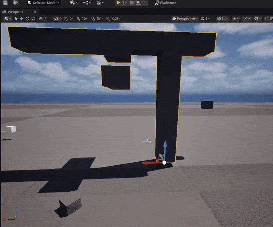
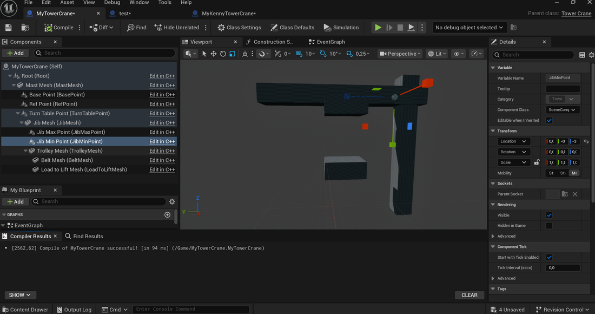
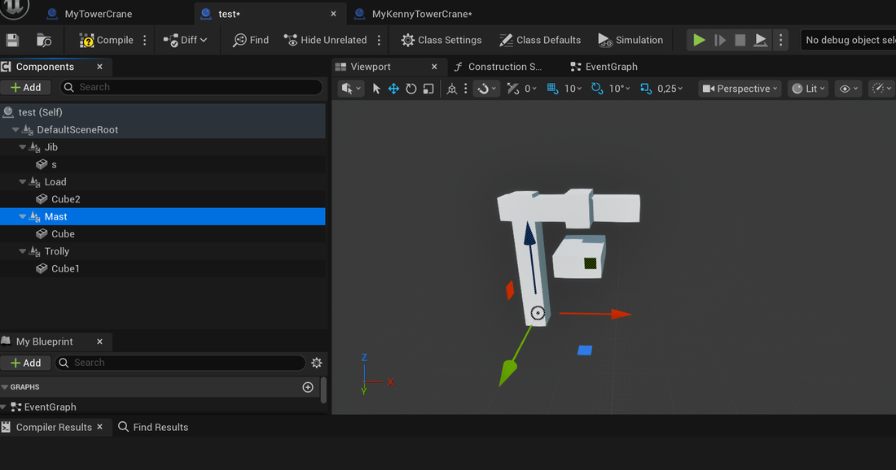
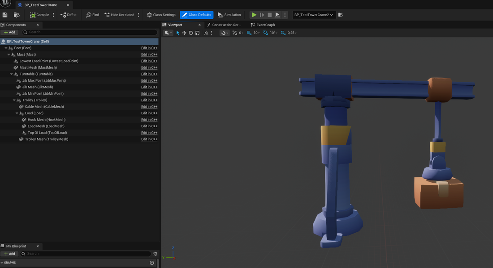
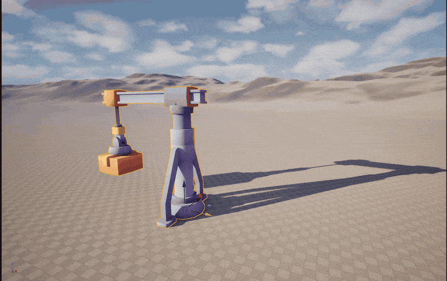
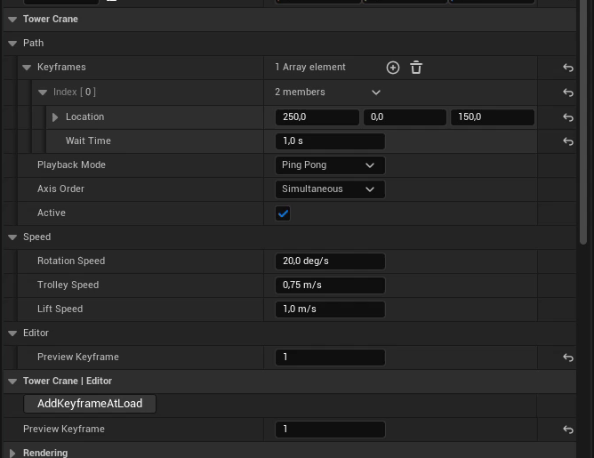

# Tower Crane

A tower crane for Unreal Engine 5, written in C++. It moves a load between keyframes that can be placed and moved in the world by designers. It also has Blueprint events to hook your own gameplay into.



## Where it comes from

I first built a version of this crane as a level ingredient for [Suck it Up](https://store.steampowered.com/app/4515400/Suck_It_Up/), a game made with a team of 25 students at Breda University of Applied Sciences. I was a part of the level team at the start and a level designer said he'd like to use a crane for platforming. Together with him I sat down and made a general design for what the crane should be able to do. Namely, I suggested making a keyframe system so the designer could adjust it for any situation in the level. 

| The level designer's sketch | The original crane prototype in Suck it Up |
| --- | --- |
|  |  |

That version worked, but setting one up was annoying. This wasn't a huge deal since we only ever ended up using one crane in the final game. However I liked my keyframe system and wanted to do better. This repository is a rewrite of it as a standalone module, with much better UX.

## The old setup and why I changed it



In the old version everything hung off the meshes in one deep hierarchy. The jib mesh was a child of the mast mesh, the trolley mesh a child of the jib mesh, and so on. Moving or scaling one mesh moved everything below it. Which was very annoying while setting up a crane with meshes. On top of that:

- Keyframes were separate actors that had to be added to a list on the crane by hand, with another list of wait times had to stay the same length and automatically update.
- The keyframes only knew the crane's reach because the crane pushed values into them, and those values started out uninitialised.
- Every crane subscribed to the editor's global "a component moved" event, so every crane recalculated whenever anything in the level moved.
- I never got around to implementing the "one axis at a time" setting.
- The cable was scaled with hard-coded values that only worked for one mesh. This part was later tagged on by a teammate and didn't really fit with the main system.

### A detour: flat pivots



My first idea to fix the hierarchy issues was to make every moving part its own empty pivot directly under the root, with its meshes underneath. I would then move all the groups in code simulating a hierarchy by hand. I made a quick test setup of the idea and quickly realised there must be a better way. This would functionally work but it felt very unintuitive and confusing to a user. 

### The new setup



The new setup keeps a hierarchy, but makes sure every mesh is a leaf. The moving parts are scene components (pivots), and the code only ever animates one value per pivot:

| Pivot | Animated by the code |
| --- | --- |
| Turntable | yaw |
| Trolley | position along the jib |
| Load | height |

Everything else belongs to the designer. Meshes are never read by the code, so they can be swapped, moved and scaled freely. 

The crane's limits come from markers that the designer drags into place in the Blueprint viewport.  `JibMinPoint` and `JibMaxPoint` for the trolley's range, `LowestLoadPoint` for how far the load can be lowered, and `TopOfLoad` so the load can't be pulled into the jib. Every marker is read in the space of the pivot it belongs to, so the crane's own movement never changes what it reads.

I chose this approach over simple variable settings since this was much easier to visually nail the sizes of the crane meshes. I really wanted this system to easily work with any meshes people might have.

## Old code and new code

**Keyframes.** The old crane kept its keyframes as actors, with the wait times in a separate list that only got resized when you edited the keyframe list:

```cpp
// Old
UPROPERTY(EditAnywhere, BlueprintReadWrite, Category = "TowerCraneSettings")
TArray<ACraneKeyframe*> CraneKeyFrames;

UPROPERTY(EditAnywhere, BlueprintReadWrite, Category = "TowerCraneSettings")
TArray<float> CraneWaitTimes;
```

Now a keyframe is a small struct stored on the crane itself, so the location and the wait time can't get out of sync, and there is no extra overhead of new actors to manage. I also discovered `MakeEditWidget` which gives every keyframe location a handle in the viewport to drag around. Which was the main reason I created Actors in the first place.

```cpp
// New
USTRUCT(BlueprintType)
struct PLATFORMERTOWERCRANE_API FCraneKeyframe
{
	GENERATED_BODY()

	UPROPERTY(EditAnywhere, BlueprintReadWrite, Category = "Tower Crane", meta = (MakeEditWidget = true))
	FVector Location = FVector(500.0f, 0.0f, 200.0f);

	UPROPERTY(EditAnywhere, BlueprintReadWrite, Category = "Tower Crane", meta = (ClampMin = "0.0", Units = "Seconds"))
	float WaitTime = 1.0f;
};
```

**Movement.** In the first version of the crane the limitation calculation and the movement were interwoven into one big mess. This made it hard to read the code and to adjust a part of it. It even resulted in some duplicate code. This was all a result of very quick prototyping that sadly proved to be not so temporary as we continued development. 

 However, now the crane's limits are stored in `FCraneLimits` and the target pose is stored in three numbers in `FCranePose`.  (turntable yaw, trolley distance and load height) A single function turns a location into the closest reachable pose, and all movement functions share it.

```cpp
// New
FCranePose ATowerCrane::PoseForLocation(const FVector& CraneLocation) const
{
	const FVector Offset = ActorToMastSpace(CraneLocation) - Limits.Turntable;

	FCranePose Pose;

	// Straight above or below the axis there is no direction to turn to, so keep the current yaw
	if (Offset.Size2D() > KINDA_SMALL_NUMBER)
	{
		Pose.TurnTableYaw = FMath::RadiansToDegrees(FMath::Atan2(Offset.Y, Offset.X)) - Limits.JibYawOffset;
	}
	else
	{
		Pose.TurnTableYaw = CurrentPose.TurnTableYaw;
	}

	const float Reach = FMath::Clamp(Offset.Size2D(), Limits.MinReach, Limits.MaxReach);
	Pose.TrolleyDistance = Reach - Limits.MinReach;
	Pose.LoadHeight = FMath::Clamp(Offset.Z, Limits.LowestLoadHeight, Limits.HighestLoadHeight);
	return Pose;
}
```

`LocationForPose` does the reverse, and `ApplyPose` places the turntable, trolley, load and cable for a pose.

**Editor events.** The old crane listened to every component change in the editor.

```cpp
// Old
GEngine->OnComponentTransformChanged().AddUObject(this, &ATowerCrane::OnEditorCompMoved);
```

The new crane doesn't have this problem. All the markers it reads are its own components, so recalculating in `OnConstruction`, which Unreal already calls whenever the crane is moved or edited, is enough. 

And whenever a keyframe is moved the local PostEditChangeProperty gets called which quickly filters out any change unrelated to the keyframes. 

```cpp
#if WITH_EDITOR
void ATowerCrane::PostEditChangeProperty(FPropertyChangedEvent& PropertyChangedEvent)
{
	Super::PostEditChangeProperty(PropertyChangedEvent);

	if (!Keyframes.IsValidIndex(0)) 
	{
		return;
	}
	if (PropertyChangedEvent.MemberProperty) 
	{
		if (PropertyChangedEvent.MemberProperty->GetFName() == GET_MEMBER_NAME_CHECKED(ATowerCrane, Keyframes)) 
		{
			SnapKeyframesIntoReach();
			return;
		}

	}
	if (PropertyChangedEvent.Property) 
	{
		if (PropertyChangedEvent.Property->GetOwnerStruct() == FCraneKeyframe::StaticStruct()) 
		{
			SnapKeyframesIntoReach();
		}
	}
}
#endif

```
## Using it



Keyframes show up as handles in the viewport. Editing a keyframe snaps it into the crane's reach, and `PreviewKeyframe` shows the crane in the pose of any keyframe. This way you can see exactly where the load will be and what the crane will look like in game. The "Add Keyframe At Load" button adds a keyframe where the load currently hangs. When the markers are set up wrong, the crane logs a warning that says what to fix.



At runtime a small state machine moves the crane between keyframes and waits at each one. It can loop, ping-pong or play once, and move all three axes at the same time or one after another. Designers can bind to `OnKeyframeReached` and `OnKeyframeLeft`, and start or stop a crane with `SetCraneActive`. The cable is scaled along its length to always reach from the trolley to the load.

### Setting up a crane

1. Create a Blueprint based on `TowerCrane`.
2. Assign meshes to the mesh components, and scale or offset them however you like. The cable mesh needs its pivot-point to be at the top.
3. Move `Turntable` to the top of the mast, `JibMinPoint` and `JibMaxPoint` to where the trolley should stop, `LowestLoadPoint` to the lowest point the load may reach, and `TopOfLoad` to the top of your load.
4. Place the crane in a level, add keyframes and drag them where you want them.
5. Set wait times, speeds and the playback mode, and bind the events for any level logic.

## Files

| File | Contents |
| --- | --- |
| `Source/PlatformerTowerCrane/Public/TowerCrane.h` | The crane actor, the keyframe and pose structs, and the playback and axis order enums |
| `Source/PlatformerTowerCrane/Private/TowerCrane.cpp` | Implementation |
| `Source/PlatformerTowerCrane/Public/PlatformerTowerCrane.h`, `Source/PlatformerTowerCrane/Private/PlatformerTowerCrane.cpp` | Module boilerplate |

## Limitations and next steps

- Moving one axis at a time always rotates first, then moves the trolley, then lifts. This would normally depend on the situation, for example moving something from the ground always starts with lifting it up first.
- The jib markers are expected to lie on a line pointing away from the turntable's axis.
- Next steps: drawing the crane's reach in the editor, moving the runtime movement into its own component, and packaging this as a plugin.
